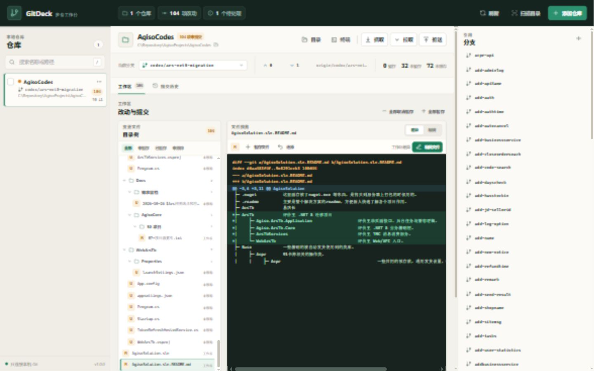

# GitDeck

GitDeck 是一个零依赖、本地运行的多仓库 Git 工作台。它把常用仓库放在同一个窗口里，提供接近 TortoiseGit 的常用动作，但使用更适合多仓库并行处理的总览界面。



## 能做什么

- 同时查看多个仓库的当前分支、未提交改动、领先/落后和最近提交。
- 支持多个工作区，左侧下拉框直接切换；每个工作区可独立维护多个 Git 仓库。
- 仓库列表支持拖拽自定义排序，刷新和重启后保持顺序。
- 工作区旁的新增按钮会把仓库加入当前工作区；仓库可从工作区移出或批量移出，只删除 GitDeck 中的归属记录，不删除磁盘目录和 Git 数据。
- 工作区使用左侧目录树、右侧内联 Diff，点击文件即可预览改动。
- 左侧变更文件支持文件夹树视图和平铺视图切换，并记住上次选择。
- 仓库列表、目录树、分支面板之间的三条分隔条均可左右拖拽，支持方向键微调、双击恢复默认，并记住调整后的宽度。
- 可直接在内置编辑器修改文件并用 `Ctrl+S` 保存，保存后 Diff 与工作区状态同步更新。
- 目录树支持多选文件、全选当前筛选和批量还原；批量还原只执行一次 Git 操作并只刷新一次仓库状态。
- 勾选文件后可批量暂存；提交时会自动暂存并只提交勾选内容，不会带上其他已暂存文件。
- 在一个窗口中暂存、取消暂存、还原文件、提交、切换/创建/合并/删除本地分支。
- 分支列表显示最近提交时间与作者，支持多选、全选可删和批量删除；删除时可选择同步删除匹配的远程分支。
- 未合并分支默认拒绝删除；确认不再需要提交后，可在删除弹窗中显式启用 `-D` 强制删除。
- 分支视图支持点击整行勾选，行内操作按钮仍执行各自动作。
- 分支面板支持按分支名或作者实时搜索，批量选择与删除范围跟随当前搜索结果。
- 右侧面板支持“提交历史 / 分支”切换，默认显示提交历史。
- 右侧提交历史可在“当前分支”和“所有分支”间切换，展示多色提交树和分支/远端徽标。
- 管理 Stash，打开仓库目录或终端。
- 多选仓库后批量抓取、快进拉取或推送。
- 通过仓库右键菜单快速操作，和 TortoiseGit 的使用习惯接近。
- 仓库工具栏可直接在 TortoiseGit 日志界面中打开当前仓库。
- 扫描上级目录，一次发现多个 Git 仓库。

所有数据只保存在本机。GitDeck 不连接第三方托管平台，也不会代替 Git 处理凭据；推送和私有仓库认证沿用本机 Git 的凭据配置。

## 开发与 AI 协作

维护前先阅读（文档中所有路径相对当前 Git 仓库根目录 `<repo>`；开发、测试、清理一律在 `<repo>` 内完成，不引用任何机器专属固定目录）：

- [AGENTS.md](./AGENTS.md)：后续 AI/开发者的强制工作约定。
- [文档索引](./docs/README.md)：按任务选择架构、API、数据、UI 或测试文档。
- [功能地图](./docs/FEATURES.md)：从功能快速定位代码与测试。
- [AI 工作手册](./docs/AGENT-GUIDE.md)：上下文加载、变更流程、验证与清理规范。
- [迭代日志](./docs/ITERATION-LOG.md)：已实现功能和问题修复记录。

文档一致性检查：

```powershell
node tools/check-docs.js
```

## 启动

要求：

- Windows 10/11
- Node.js 18 或更新版本
- 已安装 Git，并能在命令行执行 `git`

直接双击 [start.cmd](./start.cmd)，或在当前目录执行：

```powershell
node server.js
```

服务默认监听 `http://127.0.0.1:4321`。端口被占用时会自动尝试后续端口。

## 数据位置

仓库列表默认保存在：

```text
data/repositories.json
```

如需放到其他位置，可在启动前设置 `GITDECK_DATA_DIR`。开发或自动化场景可设置 `GITDECK_NO_OPEN=1`，避免自动打开浏览器。

## 安全边界

- 服务只绑定 `127.0.0.1`。
- 每次启动生成独立会话令牌，API 请求必须携带该令牌。
- 前端不能传入任意 shell 命令；所有写操作都经过动作白名单。
- 文件操作会校验路径必须位于目标仓库内，并拒绝直接操作 `.git`。
- 文件保存带内容哈希校验，检测外部修改，避免静默覆盖；同时保留原文件的 LF/CRLF 换行格式。
- 对用户明确选择或添加的仓库，执行 Git 时仅对该仓库根路径传入 `safe.directory`，避免 Windows 账号所有权差异造成误报；不会全局关闭 Git 的仓库所有权校验。
- 拉取默认使用 `--ff-only`，不会自动制造合并提交；批量推送、还原文件等有副作用操作会先确认。

## 测试

```powershell
node --test
```

测试包含 Git 输出解析和真实临时仓库的 API 端到端流程。

## 当前边界

GitDeck 当前聚焦 Windows 桌面上的日常仓库管理，不包含冲突解决编辑器、交互式 rebase、子模块专页或 GitHub/GitLab API 集成。需要这些高级操作时仍可点击“终端”回到原生 Git。
